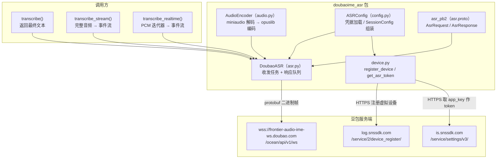
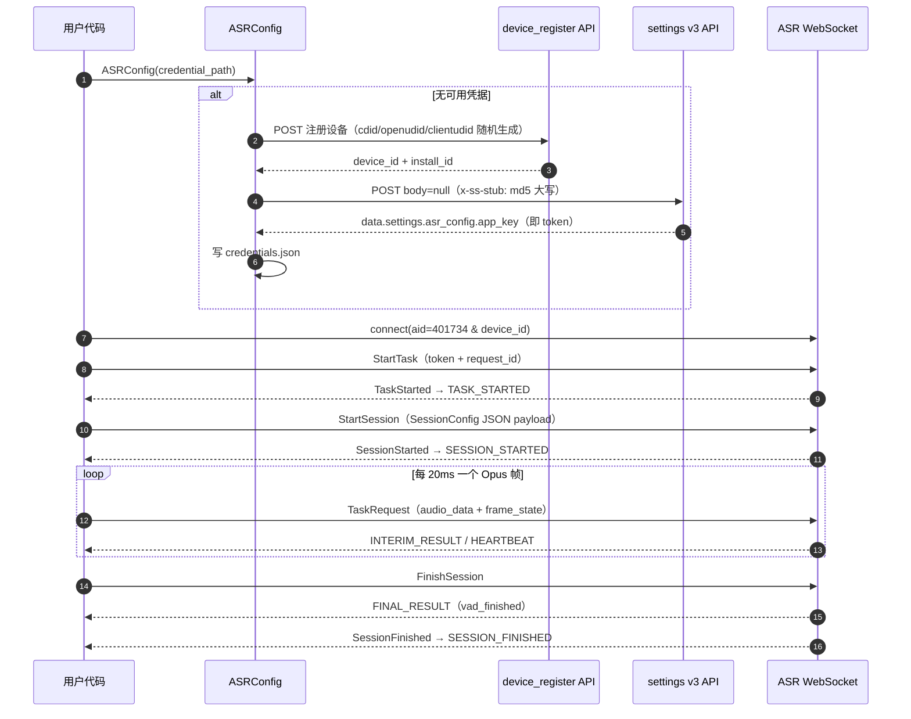
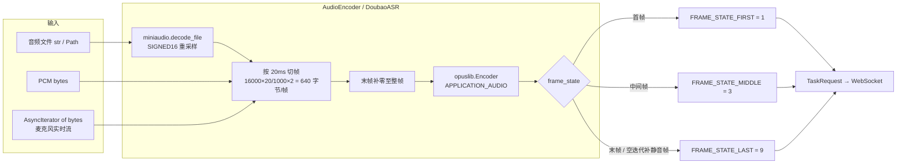
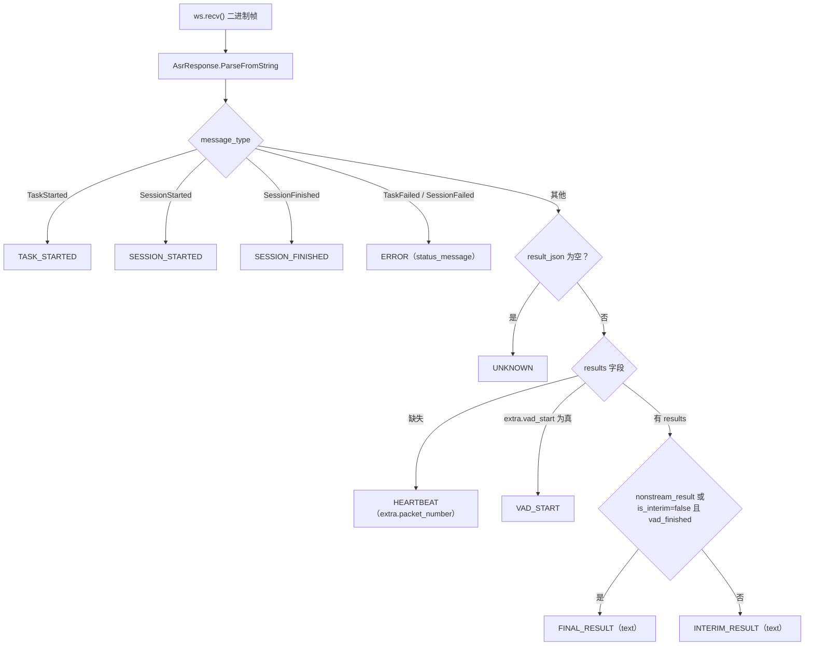
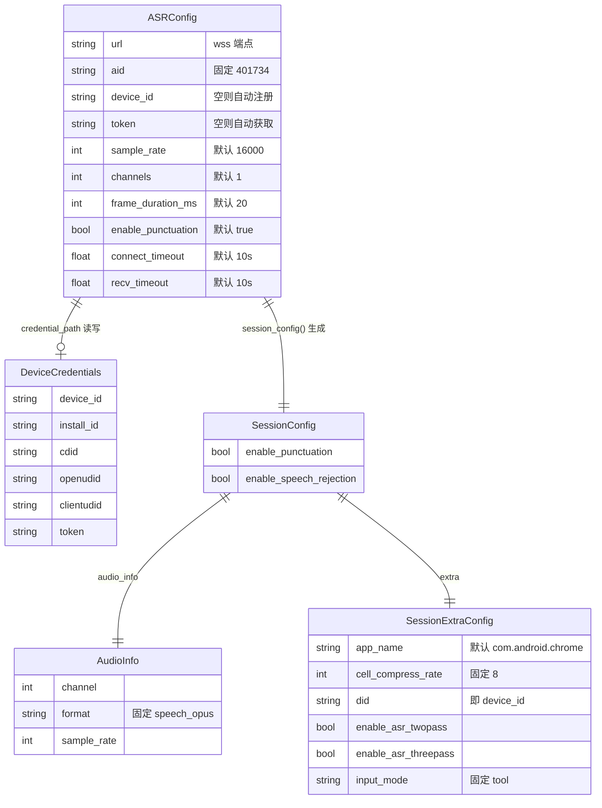

<div align="center">

> [English](./README_en.md) | **简体中文**


# doubao-asr-free — 豆包输入法语音识别 Python 客户端

**逆向豆包输入法 ASR 协议：WebSocket + Protobuf + Opus，三行代码把中文语音变成文字。**


</div>

---

## 它解决什么问题

豆包输入法的语音识别又快又准，但官方**没有开放 API**。本项目通过分析安卓端豆包输入法（`oime`，`com.bytedance.android.doubaoime`）的通信协议，用纯 Python 复刻了它的识别客户端：自动注册虚拟设备、拿 token、走 WebSocket + Protobuf 二进制协议推 Opus 音频流，拿到带中间结果、VAD 事件和标点恢复的识别文本。

> ⚠️ **本仓库是镜像 + 文档美化仓**：代码 100% 来自上游 [zhuiyue132/doubao-asr](https://github.com/zhuiyue132/doubao-asr)，仅重写 README、补充架构图与图标，未改动任何源码。请优先关注和 Star 上游项目。
>
> 仅供学习研究；非官方接口，协议随时可能变更失效。

---

## ✨ 功能

- **三种识别模式**：`transcribe`（一把梭拿最终结果）、`transcribe_stream`（异步迭代中间/最终结果与 VAD 事件）、`transcribe_realtime`（吃 PCM 异步迭代器，支持麦克风持续输入）
- **零配置启动**：不填 `device_id`/`token` 时自动模拟 Pixel 7 Pro 注册虚拟设备、取 ASR token，并可落盘到 `credentials.json` 复用
- **全格式音频进、Opus 流出去**：`miniaudio` 解码任意音频文件为 16-bit PCM，`opuslib` 编码为 20ms Opus 帧，末帧自动补零
- **真实流式语义**：区分 `INTERIM_RESULT` / `FINAL_RESULT`（依 `nonstream_result` 或 `is_interim=false` + `is_vad_finished` 判定），心跳包仅用于重置超时不上抛
- **可模拟真实语速**：`realtime=True` 按帧时长插入延迟，模拟真人说话节奏

---

## 🚀 快速开始

### 方式一：面向 AI Agent（一键提示词，推荐）

````markdown
请帮我在本机安装并跑通 doubao-asr-free（豆包输入法 ASR 非官方客户端）：
1. 克隆 https://github.com/RayMorTwinkle/doubao-asr-free 并进入目录
2. 安装系统 Opus 库：macOS 用 `brew install opus`；Debian/Ubuntu 用 `sudo apt install libopus0`；Arch 用 `sudo pacman -S opus`
3. 用 Python>=3.11 安装本包：`pip install -e .`（或 `uv pip install -e .`）；跑 examples 再加 `pip install -e ".[examples]"`
4. 运行 `python examples/file_transcribe.py` 验证：它会自动注册设备并把凭据缓存到 ./credentials.json
5. 最后用 `transcribe("my.wav")` 识别一段我自己的音频，把结果打印出来
````

### 方式二：面向人类用户

```bash
# 1. 系统依赖：Opus 编解码库（opuslib 是 ctypes 绑定，必须装系统库）
brew install opus            # macOS
# sudo apt install libopus0  # Debian/Ubuntu
# sudo pacman -S opus        # Arch

# 2. 安装本包（Python >= 3.11）
git clone https://github.com/RayMorTwinkle/doubao-asr-free.git
cd doubao-asr-free
pip install -e .
pip install -e ".[examples]"   # 可选：跑 examples 需要 sounddevice + numpy

# 3. 识别一个音频文件（首次运行自动注册设备，凭据写入 ./credentials.json）
python examples/file_transcribe.py
```

最小可运行代码：

```python
import asyncio
from doubaoime_asr import transcribe, ASRConfig

async def main():
    config = ASRConfig(credential_path="./credentials.json")
    print(await transcribe("audio.wav", config=config))

asyncio.run(main())
```

> **环境要求**：Python ≥ 3.11；联网可达 `*.snssdk.com` 与 `wss://frontier-audio-ime-ws.doubao.com`；系统级 Opus 库。

---

## 🖥️ 使用

### 三个入口函数

| 函数 | 输入 | 返回 | 适用场景 |
|------|------|------|----------|
| `transcribe(audio, *, config, on_interim, realtime)` | 文件路径 `str/Path` 或 PCM `bytes` | `str` 最终文本 | 一把梭，只要结果 |
| `transcribe_stream(audio, *, config, realtime)` | 同上 | `AsyncIterator[ASRResponse]` | 要中间结果 / VAD 事件 |
| `transcribe_realtime(audio_source, *, config)` | `AsyncIterator[bytes]`（16-bit PCM） | `AsyncIterator[ASRResponse]` | 麦克风等持续音频源，迭代结束自动发 `FinishSession` |

也支持 `async with DoubaoASR(config)` 直接使用类 API。

### `ASRConfig` 关键参数

| 参数 | 默认值 | 说明 |
|------|--------|------|
| `credential_path` | `None` | 凭据缓存文件（推荐设置，避免重复注册） |
| `device_id` / `token` | `None` | 手动指定凭据，优先级最高 |
| `sample_rate` / `channels` / `frame_duration_ms` | `16000` / `1` / `20` | 音频参数（客户端默认值） |
| `enable_punctuation` | `True` | 标点恢复 |
| `enable_speech_rejection` | `False` | 拒识开关 |
| `enable_asr_twopass` / `enable_asr_threepass` | `True` / `True` | 多遍识别策略 |
| `app_name` | `"com.android.chrome"` | 伪装的前台应用（可能影响识别策略） |
| `connect_timeout` / `recv_timeout` | `10.0` / `10.0` | 连接 / 单条响应超时（秒） |

### `ResponseType` 事件流

`TASK_STARTED` → `SESSION_STARTED` → `VAD_START` → `INTERIM_RESULT` × N → `FINAL_RESULT` → `SESSION_FINISHED`；异常为 `ERROR`；`HEARTBEAT` / `UNKNOWN` 在便捷流内部消化。

### 凭据管理

`ASRConfig` 凭据优先级：**显式传入参数 > `credential_path` 文件 > 自动注册**。文件 JSON 字段：`device_id`、`install_id`、`cdid`、`openudid`、`clientudid`、`token`（对应 `DeviceCredentials` 模型）。

```python
config = ASRConfig(credential_path="~/.config/doubao-asr/credentials.json")
```

---

## 🏗️ 架构

### 系统总览



### 会话握手与音频推流时序



### 音频管线与帧状态机



### 响应解析决策树（`_parse_response`）



### 配置与数据模型



---

## 📂 目录结构

```text
doubao-asr-free/
├── doubaoime_asr/           # 核心包
│   ├── __init__.py          # 导出 DoubaoASR / ASRConfig / 三个便捷函数等
│   ├── asr.py               # DoubaoASR 客户端：握手、收发并发、响应解析
│   ├── audio.py             # AudioEncoder：miniaudio 解码 + opuslib 编码
│   ├── config.py            # ASRConfig / SessionConfig / 凭据缓存
│   ├── device.py            # 设备注册 + token 获取（snssdk 两个 HTTPS 接口）
│   ├── constants.py         # URL、aid、UA、Pixel 7 Pro 伪装参数
│   ├── asr.proto            # AsrRequest / AsrResponse / FrameState 协议定义
│   ├── asr_pb2.py           # protoc 生成的绑定
│   └── asr_pb2.pyi          # 类型存根
├── examples/
│   ├── file_transcribe.py   # 文件识别示例（transcribe + transcribe_stream）
│   └── mic_realtime.py      # 麦克风实时识别示例（sounddevice + numpy）
├── gen_proto.sh             # 用 grpc_tools.protoc 重新生成 pb2
├── pyproject.toml           # 包元数据与依赖
└── uv.lock                  # uv 锁定依赖
```

---

## 🔧 技术细节

- **WebSocket 握手**：`wss://frontier-audio-ime-ws.doubao.com/ocean/api/v1/ws?aid={aid}&device_id={device_id}`，请求头固定带 `proto-version: v2` 与 `x-custom-keepalive: true`，UA 伪装为豆包输入法 `1.1.2`（version_code `100102018`，channel `official`）。
- **设备伪装**：随机生成 `cdid`（UUID4）、`openudid`（16 位 hex）、`clientudid`（UUID4），上报 Pixel 7 Pro / Android 16（`os_api=34`）/`zh`/`Asia/Shanghai`/`wifi` 等字段（见 `constants.py` 的 `DEFAULT_DEVICE_CONFIG`）。
- **token 获取**：POST `https://is.snssdk.com/service/settings/v3/`，body 固定为 `body=null`，请求头 `x-ss-stub` 为该 body 的 MD5 大写；token 取自响应 `data.settings.asr_config.app_key`。
- **协议字段**：`AsrRequest` 中 `service_name` 恒为 `"ASR"`；`method_name` ∈ `StartTask`/`StartSession`/`TaskRequest`/`FinishSession`；`TaskRequest.payload` 是 `{"extra": {}, "timestamp_ms": <帧时间戳>}`；帧时间戳按 `起始毫秒 + 帧序号 × frame_duration_ms` 合成。
- **响应判定**：最终结果 = `results[].extra.nonstream_result` 为真，或 `is_interim=false` 且 `is_vad_finished`；`result_json` 无 `results` 视为心跳（带 `extra.packet_number`）。
- **并发模型**：`asyncio` 双任务（发送 + 接收），响应经 `asyncio.Queue` 上抛；流式模式每条响应受 `recv_timeout` 约束（心跳可重置计时器），实时模式不设超时、靠 WS 断开检测。
- **边界处理**：PCM 末尾不足一帧自动补零；实时迭代器结束时若刚好整除，额外发一帧静音 `FRAME_STATE_LAST` 再发 `FinishSession`；`ERROR` 响应会终止收发任务并以 `ASRError` 抛出（`transcribe` 路径）。
- **proto 再生成**：`gen_proto.sh` 调用 `uv run -m grpc_tools.protoc`，需 `dev` 额外依赖组。

---

## ❓ 常见问题

**Q：需要豆包账号 / 登录吗？**
A：不需要。首次运行自动向 `device_register` 接口注册一台"虚拟手机"拿 `device_id`，再向 settings 接口换 token，全程无登录态。

**Q：`credentials.json` 是什么？要提交吗？**
A：是设备凭据缓存（`device_id`/`install_id`/`cdid`/`openudid`/`clientudid`/`token`）。`.gitignore` 已忽略，不要提交；泄露约等于泄露这台"虚拟设备"的身份。

**Q：支持哪些音频格式？**
A：凡是 `miniaudio` 能解码的（wav/mp3/flac/ogg 等）都行，内部统一转成 16-bit PCM 再编码为 Opus。也可直接传原始 PCM `bytes`（需与 `sample_rate`/`channels` 一致）。

**Q：`realtime=True` 有什么用？**
A：按 `frame_duration_ms` 在帧间 `asyncio.sleep`，模拟真实语速推流；默认 `False` 会尽快发完、更快出结果（上游注释：是否触发风控未知）。

**Q：这个仓库和上游什么关系？**
A：这是 [zhuiyue132/doubao-asr](https://github.com/zhuiyue132/doubao-asr) 的镜像导入仓（`.git` 历史已剥离为单提交 `d07aced`），仅做 README 双语化、架构图与图标美化；上游 README 中提到的原始安装地址为 `github.com/starccy/doubaoime-asr`。

---

## ⚠️ 注意事项

- **非官方接口**：协议逆向自安卓客户端，服务端随时可能变更导致失效；不保证可用性与稳定性。
- **合规风险**：模拟设备注册、伪装 UA 与包名可能触及服务端风控与 ToS，**仅供学习研究**，请勿用于生产或大规模调用。
- **系统依赖**：`opuslib` 是 ctypes 绑定，必须先装系统 Opus 库（`libopus0`/`opus`），否则 import 即失败。
- **网络可达性**：依赖 `log.snssdk.com`、`is.snssdk.com` 与 `wss://frontier-audio-ime-ws.doubao.com` 三个端点。

---

## 📄 License

**沿用上游（未声明）**：上游仓库未附带 LICENSE 文件，本镜像仓不另行授权。使用前请自行评估合规风险。

---

## 🙏 致谢 / Credits

- **上游作者**：[zhuiyue132/doubao-asr](https://github.com/zhuiyue132/doubao-asr) —— 协议分析、客户端实现与全部代码均来自该项目，本仓仅为镜像 + 文档美化。所有功劳归于上游作者。
- 上游 README 另提及 [starccy/doubaoime-asr](https://github.com/starccy/doubaoime-asr) 作为其安装来源，一并致谢。
- 示例音频来自 [liangstein/Chinese-speech-to-text](https://github.com/liangstein/Chinese-speech-to-text)。

<div align="center">
<sub>doubao-asr-free · 让豆包输入法的耳朵，装进你的 Python 脚本</sub>
</div>
