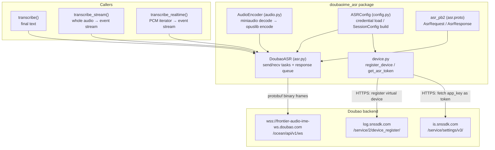
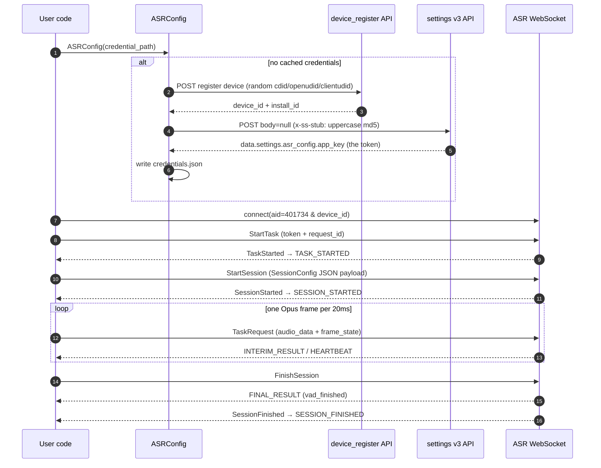
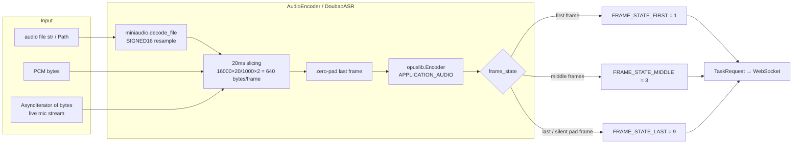
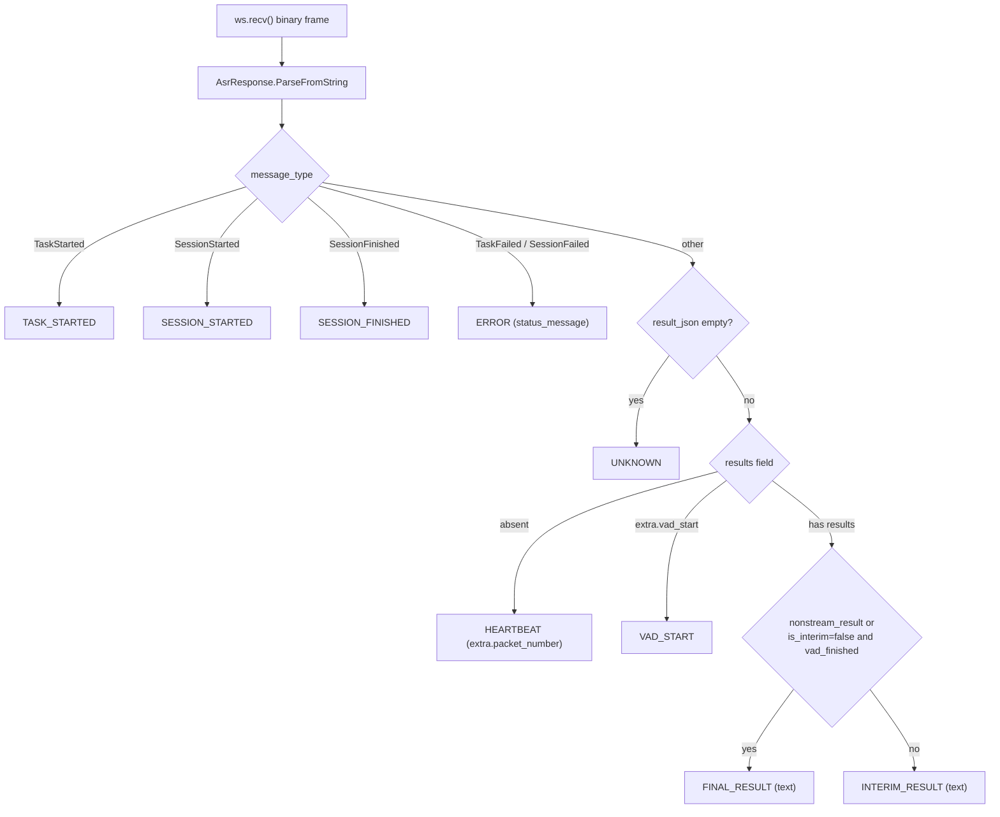
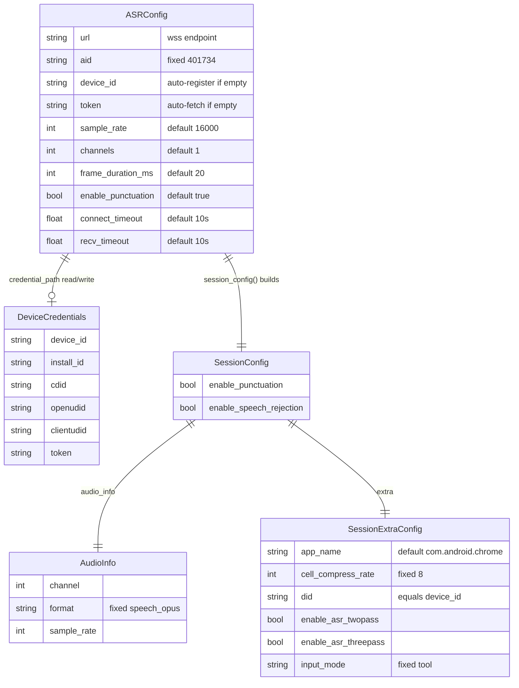

<div align="center">

> **English** | [简体中文](./README.md)


# doubao-asr-free — Doubao Input Method ASR Python Client

**A reverse-engineered client for Doubao IME's speech recognition: WebSocket + Protobuf + Opus — Chinese speech to text in three lines.**


</div>

---

## Why it exists

Doubao Input Method's speech recognition is fast and accurate, but **there is no official API**. By analyzing the wire protocol of the Android Doubao IME app (`oime`, `com.bytedance.android.doubaoime`), this project reimplements the client in pure Python: it registers a virtual device, fetches a token, streams Opus audio over a WebSocket + Protobuf binary protocol, and returns transcription text with interim results, VAD events, and punctuation restoration.

> ⚠️ **This repository is a mirror + documentation beautification**: 100% of the code comes from the upstream project [zhuiyue132/doubao-asr](https://github.com/zhuiyue132/doubao-asr). Only the README, architecture diagrams, and the icon were (re)created — no source code was modified. Please follow and star the upstream project first.
>
> For learning and research only. This is an unofficial interface; the protocol may change or break at any time.

---

## ✨ Features

- **Three recognition modes**: `transcribe` (one-shot final text), `transcribe_stream` (async iterator of interim/final results and VAD events), `transcribe_realtime` (consumes a PCM async iterator, e.g. a live microphone stream)
- **Zero-config bootstrap**: without `device_id`/`token`, it automatically registers a virtual Pixel 7 Pro device, obtains an ASR token, and can persist credentials to `credentials.json` for reuse
- **Any audio in, Opus out**: `miniaudio` decodes any audio file to 16-bit PCM; `opuslib` encodes it into 20 ms Opus frames with automatic zero-padding on the last frame
- **Real streaming semantics**: distinguishes `INTERIM_RESULT` / `FINAL_RESULT` (via `nonstream_result`, or `is_interim=false` + `is_vad_finished`); heartbeat frames only reset the timeout and are never surfaced
- **Simulated real-time pacing**: `realtime=True` inserts per-frame delays to mimic human speech tempo

---

## 🚀 Quick Start

### Option 1: For AI Agents (one-shot prompt, recommended)

````markdown
Install and verify doubao-asr-free (unofficial Doubao IME ASR client) on this machine:
1. Clone https://github.com/RayMorTwinkle/doubao-asr-free and cd into it
2. Install the system Opus library: `brew install opus` on macOS; `sudo apt install libopus0` on Debian/Ubuntu; `sudo pacman -S opus` on Arch
3. Install the package with Python>=3.11: `pip install -e .` (or `uv pip install -e .`); add `pip install -e ".[examples]"` to run the examples
4. Run `python examples/file_transcribe.py` — it auto-registers a device and caches credentials to ./credentials.json
5. Finally transcribe one of my own audio files with `transcribe("my.wav")` and print the result
````

### Option 2: For Humans

```bash
# 1. System dependency: the Opus codec library (opuslib is a ctypes binding)
brew install opus            # macOS
# sudo apt install libopus0  # Debian/Ubuntu
# sudo pacman -S opus        # Arch

# 2. Install the package (Python >= 3.11)
git clone https://github.com/RayMorTwinkle/doubao-asr-free.git
cd doubao-asr-free
pip install -e .
pip install -e ".[examples]"   # optional: examples need sounddevice + numpy

# 3. Transcribe an audio file (first run auto-registers a device into ./credentials.json)
python examples/file_transcribe.py
```

Minimal runnable code:

```python
import asyncio
from doubaoime_asr import transcribe, ASRConfig

async def main():
    config = ASRConfig(credential_path="./credentials.json")
    print(await transcribe("audio.wav", config=config))

asyncio.run(main())
```

> **Requirements**: Python ≥ 3.11; network access to `*.snssdk.com` and `wss://frontier-audio-ime-ws.doubao.com`; a system-level Opus library.

---

## 🖥️ Usage

### Three entry points

| Function | Input | Returns | Use case |
|----------|-------|---------|----------|
| `transcribe(audio, *, config, on_interim, realtime)` | file path `str/Path` or PCM `bytes` | `str` final text | one-shot, text only |
| `transcribe_stream(audio, *, config, realtime)` | same as above | `AsyncIterator[ASRResponse]` | interim results / VAD events |
| `transcribe_realtime(audio_source, *, config)` | `AsyncIterator[bytes]` (16-bit PCM) | `AsyncIterator[ASRResponse]` | continuous sources like a mic; sends `FinishSession` when the iterator ends |

You can also use the class API directly via `async with DoubaoASR(config)`.

### Key `ASRConfig` parameters

| Parameter | Default | Description |
|-----------|---------|-------------|
| `credential_path` | `None` | credential cache file (recommended; avoids re-registration) |
| `device_id` / `token` | `None` | manual credentials, highest priority |
| `sample_rate` / `channels` / `frame_duration_ms` | `16000` / `1` / `20` | audio parameters (client defaults) |
| `enable_punctuation` | `True` | punctuation restoration |
| `enable_speech_rejection` | `False` | speech rejection toggle |
| `enable_asr_twopass` / `enable_asr_threepass` | `True` / `True` | multi-pass recognition strategies |
| `app_name` | `"com.android.chrome"` | spoofed foreground app (may affect recognition strategy) |
| `connect_timeout` / `recv_timeout` | `10.0` / `10.0` | connect / per-response timeout (seconds) |

### `ResponseType` event stream

`TASK_STARTED` → `SESSION_STARTED` → `VAD_START` → `INTERIM_RESULT` × N → `FINAL_RESULT` → `SESSION_FINISHED`; `ERROR` on failure; `HEARTBEAT` / `UNKNOWN` are handled internally.

### Credential management

Credential priority in `ASRConfig`: **explicit arguments > `credential_path` file > auto-registration**. The JSON file stores `device_id`, `install_id`, `cdid`, `openudid`, `clientudid`, `token` (the `DeviceCredentials` model).

```python
config = ASRConfig(credential_path="~/.config/doubao-asr/credentials.json")
```

---

## 🏗️ Architecture

### System overview



### Session handshake & audio streaming



### Audio pipeline & frame state machine



### Response parsing decision tree (`_parse_response`)



### Configuration & data model



---

## 📂 Project layout

```text
doubao-asr-free/
├── doubaoime_asr/           # core package
│   ├── __init__.py          # exports DoubaoASR / ASRConfig / three helpers
│   ├── asr.py               # DoubaoASR client: handshake, send/recv, parsing
│   ├── audio.py             # AudioEncoder: miniaudio decode + opuslib encode
│   ├── config.py            # ASRConfig / SessionConfig / credential cache
│   ├── device.py            # device registration + token fetch (snssdk APIs)
│   ├── constants.py         # URLs, aid, UA, Pixel 7 Pro spoofing parameters
│   ├── asr.proto            # AsrRequest / AsrResponse / FrameState protocol
│   ├── asr_pb2.py           # protoc-generated bindings
│   └── asr_pb2.pyi          # type stubs
├── examples/
│   ├── file_transcribe.py   # file transcription (transcribe + stream)
│   └── mic_realtime.py      # live mic transcription (sounddevice + numpy)
├── gen_proto.sh             # regenerate pb2 via grpc_tools.protoc
├── pyproject.toml           # package metadata & dependencies
└── uv.lock                  # locked dependencies (uv)
```

---

## 🔧 Technical notes

- **WebSocket handshake**: `wss://frontier-audio-ime-ws.doubao.com/ocean/api/v1/ws?aid={aid}&device_id={device_id}` with fixed headers `proto-version: v2` and `x-custom-keepalive: true`; UA spoofs Doubao IME `1.1.2` (version_code `100102018`, channel `official`).
- **Device spoofing**: random `cdid` (UUID4), `openudid` (16-hex), `clientudid` (UUID4); reports Pixel 7 Pro / Android 16 (`os_api=34`) / `zh` / `Asia/Shanghai` / `wifi` (see `DEFAULT_DEVICE_CONFIG` in `constants.py`).
- **Token fetch**: POST `https://is.snssdk.com/service/settings/v3/` with a fixed body `body=null`; the `x-ss-stub` header is the uppercase MD5 of that body. The token is `data.settings.asr_config.app_key` in the response.
- **Protocol fields**: `AsrRequest.service_name` is always `"ASR"`; `method_name` ∈ `StartTask`/`StartSession`/`TaskRequest`/`FinishSession`; `TaskRequest.payload` is `{"extra": {}, "timestamp_ms": <frame ts>}`; frame timestamps are `start_ms + index × frame_duration_ms`.
- **Result semantics**: a result is final when `results[].extra.nonstream_result` is true, or `is_interim=false` and `is_vad_finished`; a `result_json` without `results` is treated as a heartbeat (carrying `extra.packet_number`).
- **Concurrency model**: two `asyncio` tasks (send + receive) feeding an `asyncio.Queue`; in stream mode each response is bounded by `recv_timeout` (heartbeats reset the timer); realtime mode uses no timeout and relies on WebSocket close detection.
- **Edge cases**: PCM tails are zero-padded to a full frame; when a realtime iterator ends on an exact frame boundary, an extra silent `FRAME_STATE_LAST` frame is sent before `FinishSession`; an `ERROR` response cancels both tasks and is raised as `ASRError` on the `transcribe` path.
- **Regenerating protos**: `gen_proto.sh` runs `uv run -m grpc_tools.protoc` — requires the `dev` extras group.

---

## ❓ FAQ

**Q: Do I need a Doubao account or login?**
A: No. On first run the client registers a "virtual phone" via `device_register` to obtain a `device_id`, then exchanges it for a token via the settings API — no login state is involved.

**Q: What is `credentials.json`? Should I commit it?**
A: It's the device credential cache (`device_id`/`install_id`/`cdid`/`openudid`/`clientudid`/`token`). It's already in `.gitignore` — never commit it; leaking it is equivalent to leaking that virtual device's identity.

**Q: Which audio formats are supported?**
A: Anything `miniaudio` can decode (wav/mp3/flac/ogg, etc.) — internally everything becomes 16-bit PCM before Opus encoding. You can also pass raw PCM `bytes` (matching `sample_rate`/`channels`).

**Q: What does `realtime=True` do?**
A: It sleeps `frame_duration_ms` between frames to mimic real speech pace; the default `False` sends everything ASAP for faster results (per upstream's comment: whether this triggers rate limiting is unknown).

**Q: How does this repo relate to upstream?**
A: This is a mirror import of [zhuiyue132/doubao-asr](https://github.com/zhuiyue132/doubao-asr) (`.git` history squashed into the single commit `d07aced`), with bilingual docs, diagrams, and an icon added. The upstream README also references `github.com/starccy/doubaoime-asr` as its original install source.

---

## ⚠️ Notes

- **Unofficial API**: reverse-engineered from the Android client; the server may change the protocol at any time — availability and stability are not guaranteed.
- **Compliance risk**: emulated device registration plus spoofed UA/package name may trip server-side risk controls and ToS. **For learning and research only** — do not use in production or at scale.
- **System dependency**: `opuslib` is a ctypes binding; a system Opus library (`libopus0`/`opus`) is required or import fails immediately.
- **Connectivity**: depends on `log.snssdk.com`, `is.snssdk.com`, and `wss://frontier-audio-ime-ws.doubao.com`.

---

## 📄 License

**Inherits upstream (undeclared)**: the upstream repository ships no LICENSE file; this mirror grants no additional rights. Evaluate compliance risks before use.

---

## 🙏 Credits

- **Upstream author**: [zhuiyue132/doubao-asr](https://github.com/zhuiyue132/doubao-asr) — the protocol analysis, client implementation, and all code belong to that project; this repo is only a mirror + documentation beautification. All credit goes to the upstream author.
- The upstream README also mentions [starccy/doubaoime-asr](https://github.com/starccy/doubaoime-asr) as its install source — thanks as well.
- The demo audio comes from [liangstein/Chinese-speech-to-text](https://github.com/liangstein/Chinese-speech-to-text).

<div align="center">
<sub>doubao-asr-free · put Doubao IME's ears inside your Python scripts</sub>
</div>
